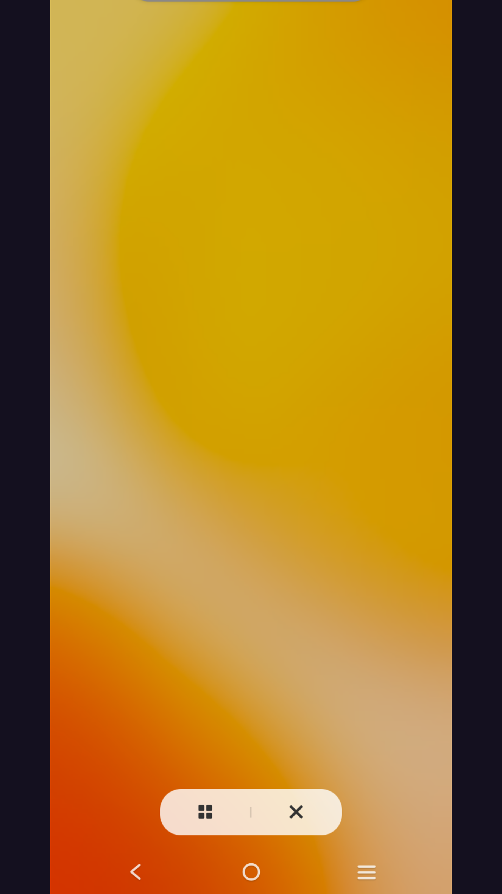
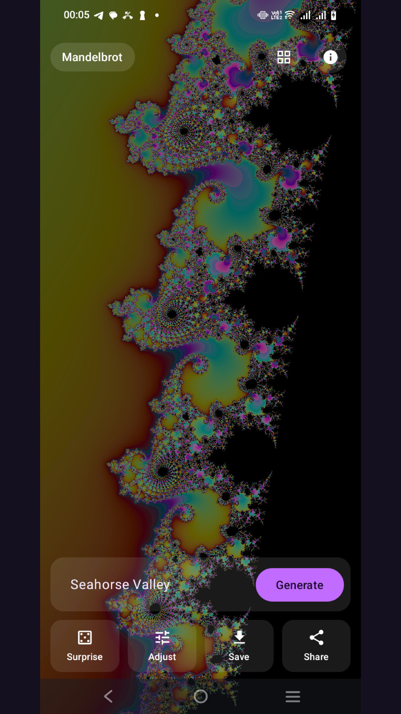
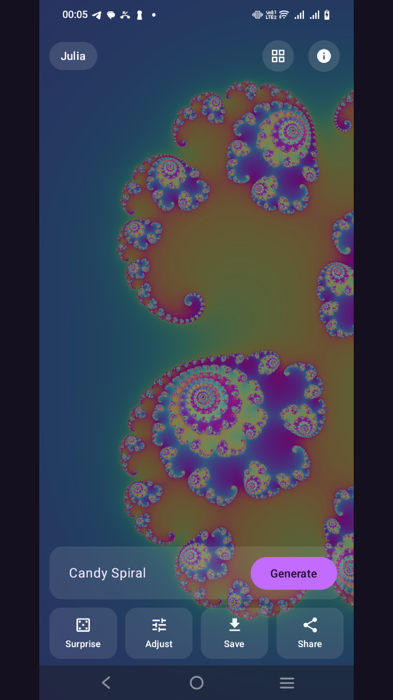
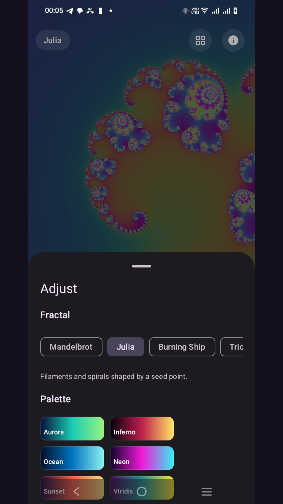
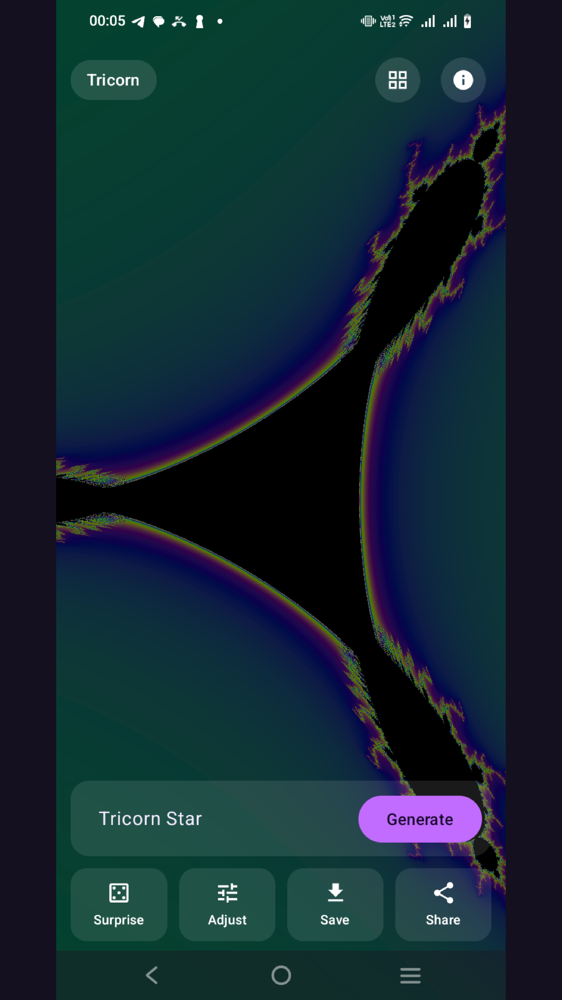

<div align="center">

# Tertiary Fractal

[](https://play.google.com/store/apps/details?id=com.tertiaryinfotech.fractalexplorerapp)

[](https://developer.android.com)
[](https://kotlinlang.org)
[](https://developer.android.com/jetpack/compose)
[](https://www.khronos.org/opengles/)
[](https://developer.android.com)
[](#license)

**A native Android fractal-art generator — type a word, get living art.**

<p><a href="https://play.google.com/store/apps/details?id=com.tertiaryinfotech.fractalexplorerapp"></a></p>

Generate colorful Mandelbrot, Julia, Burning Ship, Tricorn, Phoenix and Celtic fractals,
rendered live on the GPU. Fully offline. No backend, no tracking.

[Report Bug](https://github.com/alfredang/fractalapp-android/issues) · [Request Feature](https://github.com/alfredang/fractalapp-android/issues)

</div>

## Screenshot

<div align="center">



| Seahorse Valley | Candy Palette | Adjust Controls | Tricorn |
|:---:|:---:|:---:|:---:|
|  |  |  |  |

</div>

## About

**Tertiary Fractal** is a native Android fractal-art generator built with Kotlin, Jetpack
Compose and Material 3. Type a *seed* (any word or number) and a deterministic generator turns
it into a unique fractal — or tune the parameters yourself. Everything renders live on the GPU
with OpenGL ES 2.0, so you can pinch to zoom, drag to pan and double-tap to dive into infinite
detail at 60fps.

It is the Android port of the iOS app of the same name. The app is **fully offline**: no
network calls, no analytics, no data collected.

### Features

- **Seed-driven art** — any word or number deterministically generates a unique fractal via an FNV-1a + splitmix64 hash.
- **Six fractal families** — Mandelbrot, Julia, Burning Ship, Tricorn, Phoenix and Celtic.
- **Live GPU rendering** — OpenGL ES 2.0 escape-time shader for smooth, real-time exploration.
- **Gesture navigation** — pinch/double-tap to zoom, drag to pan.
- **Color palettes** — multiple palettes mapped directly in the fragment shader.
- **Fine controls** — adjust iterations, zoom, center, color and more from a Compose bottom sheet.
- **HD export** — off-screen render-to-bitmap saves high-resolution art to your gallery, or share it.
- **Presets gallery** — jump to curated views like *Seahorse Valley*.
- **Private by design** — no backend, no network, no tracking.

## Tech Stack

| Category | Technology |
|----------|------------|
| Language | Kotlin 2.0.21 (JDK 17) |
| UI | Jetpack Compose · Material 3 |
| Architecture | MVVM (ViewModel + UI state) |
| Rendering | OpenGL ES 2.0 (GLSL ES escape-time shader) |
| Image export | MediaStore (API 29+) / legacy `WRITE_EXTERNAL_STORAGE` (API ≤28) |
| Build | Gradle 8.14.3 · AGP 8.13.0 |
| SDK | minSdk 24 · targetSdk/compileSdk 36 |

## Architecture

```
┌──────────────────────────────────────────────────────────────┐
│  UI (Jetpack Compose / Material 3)                             │
│  HomeScreen · ControlsSheet · GallerySheet · AboutSheet        │
└───────────────────────────────┬──────────────────────────────┘
                                 │  observes state / sends events
┌───────────────────────────────▼──────────────────────────────┐
│  ViewModel (MVVM)                                              │
│  FractalViewModel — holds FractalParameters + UI state         │
└───────────────┬─────────────────────────────┬────────────────┘
                │                              │
┌───────────────▼──────────────┐  ┌────────────▼─────────────────┐
│  Seed                         │  │  GL Rendering                │
│  SeedGenerator                │  │  FractalGLSurfaceView        │
│  (FNV-1a + splitmix64 →       │  │  FractalRenderer             │
│   deterministic parameters)   │  │  FractalShaders (GLSL ES 2.0)│
└──────────────────────────────┘  └──────────────┬───────────────┘
                                                  │ render-to-bitmap
┌─────────────────────────────────────────────────▼──────────────┐
│  Model + Util                                                   │
│  FractalType · ColorPalette · FractalParameters · FractalPreset │
│  PhotoSaver (MediaStore) · Haptics                              │
└────────────────────────────────────────────────────────────────┘
```

## Project Structure

```
fractalapp/
├── app/
│   └── src/main/java/com/tertiaryinfotech/fractalapp/
│       ├── MainActivity.kt          # Edge-to-edge Compose host
│       ├── model/                   # FractalType, ColorPalette, FractalParameters, FractalPreset
│       ├── seed/                    # SeedGenerator (text seed → deterministic params)
│       ├── gl/                      # FractalShaders, FractalRenderer, FractalGLSurfaceView
│       ├── vm/                      # FractalViewModel (MVVM state)
│       ├── ui/                      # HomeScreen, ControlsSheet, GallerySheet, AboutSheet, Theme
│       └── util/                    # PhotoSaver (MediaStore), Haptics
├── store-assets/                    # Play Store icon, feature graphic, screenshots
├── build.gradle.kts
└── settings.gradle.kts
```

## Getting Started

### Prerequisites

- Android Studio (latest) with Android SDK 36
- JDK 17 (bundled with Android Studio)
- An Android device or emulator (API 24+)

### Clone

```bash
git clone https://github.com/alfredang/fractalapp-android.git
cd fractalapp-android
```

### Build & run

```bash
export JAVA_HOME="/Applications/Android Studio.app/Contents/jbr/Contents/Home"
export ANDROID_HOME="$HOME/Library/Android/sdk"

./gradlew :app:assembleDebug     # build the debug APK
./gradlew installDebug           # install on the connected device/emulator
```

> **Note:** the GPU `SurfaceView` does not capture correctly on the emulator with `-gpu host`.
> Run on a physical device for the best experience.

## Deployment (Google Play)

The app ships as a signed Android App Bundle.

```bash
./gradlew :app:bundleRelease     # → app/build/outputs/bundle/release/app-release.aab
```

Signing uses a gitignored `keystore.properties` and a local upload keystore — these are **not**
checked into the repository. Data safety declaration: **No data collected** (no ads, no
analytics, no network).

## Contributing

Contributions are welcome:

1. Fork the repository
2. Create a feature branch (`git checkout -b feature/amazing-feature`)
3. Commit your changes (`git commit -m 'Add amazing feature'`)
4. Push to the branch (`git push origin feature/amazing-feature`)
5. Open a Pull Request

## License

Proprietary — © Tertiary Infotech Pte. Ltd. All rights reserved.

## Developed By

**[Tertiary Infotech Pte. Ltd.](https://www.tertiaryinfotech.com)**

## Acknowledgements

- Built with [Jetpack Compose](https://developer.android.com/jetpack/compose) and [Material 3](https://m3.material.io)
- Real-time rendering powered by [OpenGL ES](https://www.khronos.org/opengles/)
- Android port of the iOS *Tertiary Fractal* app

---

<div align="center">

If you find this project interesting, please consider giving it a ⭐

</div>
